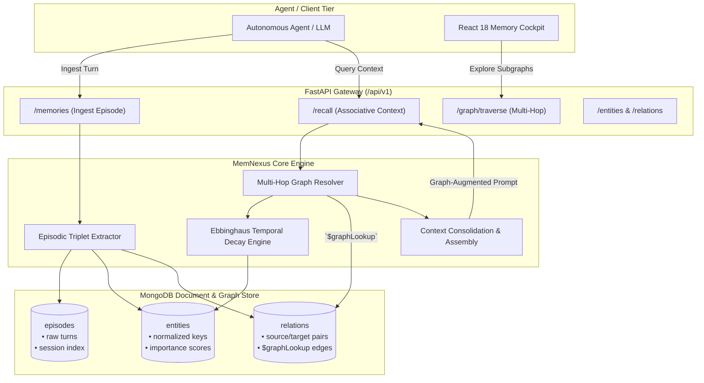

# 🧠 MemNexus — Long-Term Episodic Memory & Knowledge Graph Engine for AI Agents

[](https://fastapi.tiangolo.com)
[](https://www.mongodb.com/)
[](https://www.python.org/)
[](https://reactjs.org/)
[](https://opensource.org/licenses/MIT)

> **MemNexus** is a production-grade long-term episodic memory and semantic knowledge graph engine tailored for autonomous AI agents. It continuously extracts semantic entity-relation triplets from interaction streams, maintains dynamic memory importance using Ebbinghaus-inspired temporal decay, and performs multi-hop associative recall via MongoDB graph aggregation pipelines (`$graphLookup`).

---

## 🌟 Architectural Highlights

Autonomous LLM agents face severe context limits and drift when relying on flat conversation histories or simple vector RAG. **MemNexus** solves this by unifying:

1. **Episodic Stream Ingestion**: Captures timestamped agent interactions, conversation turns, and external tool outputs.
2. **Semantic Knowledge Graph**: Normalizes unstructured observations into rich $(S \xrightarrow{P} O)$ relational triplets (e.g. `User -> prefers -> Rust`, `ProjectX -> depends_on -> Postgres`).
3. **Ebbinghaus Memory Decay Engine**: Computes recency and reinforcement decay curves:
   $$R(t) = I_0 \cdot e^{-\lambda \cdot \Delta t} + \beta \cdot \log(1 + N_{\text{access}})$$
   where $I_0$ is initial importance, $\lambda$ is the decay rate, $\Delta t$ is elapsed time, and $\beta$ rewards repeated recall.
4. **Multi-Hop Graph Associative Recall**: Harnesses MongoDB's native `$graphLookup` aggregation operator to discover indirect relationships (2-hop and 3-hop contextual clusters) in sub-millisecond latencies.
5. **Interactive React Cockpit**: Force-directed knowledge graph visualization, real-time memory decay timeline, and associative recall simulator.

---

## 🏛️ System Architecture



---

## 📁 Repository Structure

```text
mem-nexus/
├── README.md                  # Project overview & architecture specs
├── .gitignore                 # Environment and build ignores
├── backend/
│   ├── app/
│   │   ├── __init__.py
│   │   ├── main.py            # FastAPI application entrypoint & lifespan
│   │   ├── config.py          # Pydantic v2 application settings
│   │   ├── db/
│   │   │   ├── __init__.py
│   │   │   └── mongodb.py     # Motor & PyMongo async client + index bootstrap
│   │   ├── models/
│   │   │   ├── __init__.py
│   │   │   ├── episode.py     # Episodic memory schemas
│   │   │   ├── entity.py      # Entity node schemas & decay metrics
│   │   │   ├── relation.py    # Triple relation edges & confidence
│   │   │   └── query.py       # Traversal and recall schemas
│   │   ├── routers/
│   │   │   ├── __init__.py
│   │   │   └── health.py      # Liveness & readiness probes
│   │   └── services/          # Day 2 core memory & graph services
│   └── requirements.txt       # Python dependencies
└── frontend/                  # Day 3 React 18 knowledge graph cockpit
```

---

## 🚀 Quickstart (Backend Scaffolding)

```bash
# 1. Enter backend directory
cd backend

# 2. Install dependencies
pip install -r requirements.txt

# 3. Start development server
uvicorn app.main:app --reload --port 8000
```

Verify the health check endpoint:
```bash
curl http://localhost:8000/api/v1/health
```

---

## 📅 4-Day Engineering Roadmap

- [x] **Day 1: Scaffolding & Architecture**
  - Architecture specifications, entity-relation schemas, Pydantic v2 models, MongoDB indexes, FastAPI gateway.
- [ ] **Day 2: Core Memory Engine & Graph APIs**
  - Semantic triple extraction, Ebbinghaus temporal decay calculator, multi-hop MongoDB `$graphLookup` traversal, recall synthesis APIs.
- [ ] **Day 3: Interactive React Knowledge Graph & Recall Cockpit UI**
  - Modern glassmorphic React UI, interactive SVG force-directed knowledge graph, memory timeline, live recall simulator.
- [ ] **Day 4: Multi-Hop Traversal Benchmarks, Pytest Suites & Docker Compose**
  - Latency & hop-depth benchmarks, end-to-end integration test suite, synthetic demo seeder, production Docker Compose.

---

## 📜 License
MIT License © 2026 haolubo-commits
